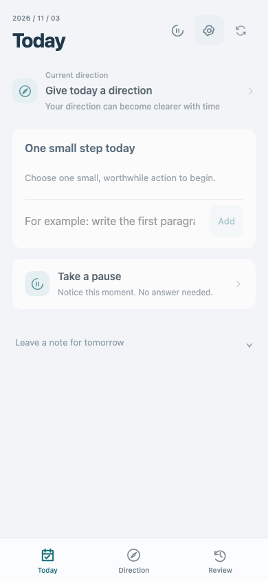
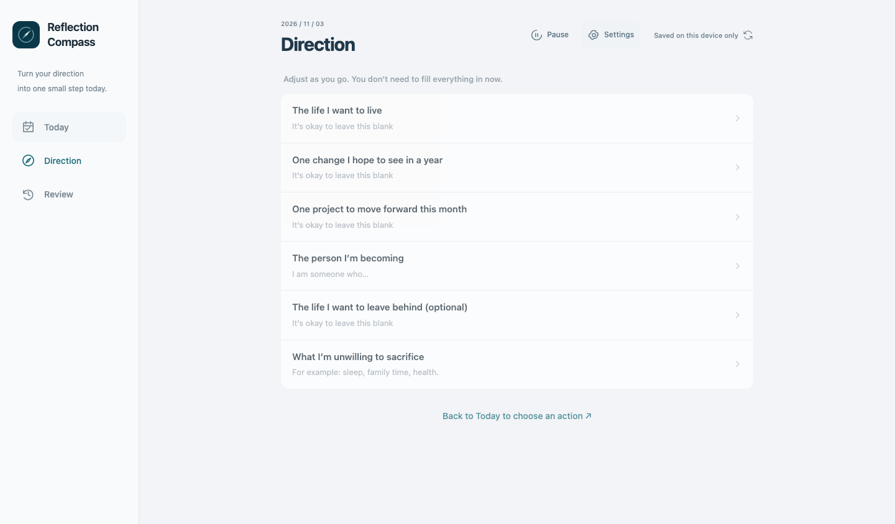

# Reflection Compass


A lightweight PWA that connects personal direction with small daily actions. Choose one thing to do, pause when useful, and adjust from experience.

[](https://github.com/Kingson4Wu/reflection-compass/actions/workflows/checks.yml)
[](https://github.com/Kingson4Wu/reflection-compass/actions/workflows/pages.yml)
[](LICENSE)

[Open the app](https://kingson4wu.github.io/reflection-compass/) · [Documentation](docs/README.md) · [Self-host](docs/DEPLOYMENT.md) · [Contribute](CONTRIBUTING.md)

The app supports English and Simplified Chinese, with the same Reflection Compass name in either language. All project documentation is in English.

## A small loop, at your pace

- **Direction:** keep a vision, a yearly change, a monthly project, and the things you will not sacrifice. Fill only what helps.
- **Today:** choose up to three actions; one is enough. Edit, complete, undo, or explicitly continue an earlier choice.
- **Pause:** consider a question without writing anything. An optional next step can become today's action.
- **Review:** revisit actions and observations; daily and weekly writing stay optional.
- **Settings:** choose a device language, manage sync and backups, and opt into reminders.

There are no streaks, scores, compulsory questionnaires, or AI-generated life advice. Returning after a break creates no backlog.



<details>
<summary>Desktop preview</summary>



</details>

## What you can run

| Capability         | Behavior                                                                                                                                                                    |
| ------------------ | --------------------------------------------------------------------------------------------------------------------------------------------------------------------------- |
| Offline records    | IndexedDB stores records on this device; the installed app can reopen offline after its assets are cached.                                                                  |
| Private sync       | Google sign-in and an invitation list; each instance supports up to five people, including its administrator. Changes merge per record; overlapping edits require a choice. |
| Optional reminders | Cloudflare Cron sends Web Push to one selected device per account, with quiet hours, pause, expiry, and limited retries.                                                    |
| Backups            | Daily server snapshots and JSON export/import with preview and integrity checks. Exported files can be saved to iCloud Drive.                                               |
| Two languages      | Interface and built-in questions switch immediately; personal writing stays unchanged. Reminder language follows the receiving device.                                      |
| Your deployment    | Static frontend on GitHub Pages; API, D1 database, and scheduled tasks on Cloudflare Workers.                                                                               |

The hosted app can be used as a local guest without signing in. Its cloud accounts are invitation-only; deploying your own instance gives you your own administrator and five-person limit. It is not an unrestricted public account service.

## Run locally

Use **Node.js 24 LTS** and npm. From a fresh clone:

```sh
git clone https://github.com/Kingson4Wu/reflection-compass.git
cd reflection-compass
npm ci
npm run setup
npm run db:local
npm run build
npm run preview
```

Open `http://localhost:8787`. A guest can start immediately. To test local cloud features, connect through **Settings → Administrator recovery** using the local `OWNER_TOKEN` in `.dev.vars`. Setup generates this file without printing secrets; do not commit it or reuse development credentials for a public test service.

These commands use the default local configuration. If you already created a `.env.local`, remove or override its production `VITE_*` values before using local preview. Do not copy `.env.example` unchanged: it contains deployment placeholders. See [development](docs/DEVELOPMENT.md) for live editing, isolated tests, and configuration details.

## Self-host

Follow the [deployment guide](docs/DEPLOYMENT.md), then [configure Google sign-in](docs/GOOGLE-LOGIN-SETUP.md) and link your administrator account. You need your own Cloudflare account, D1 database, Google Web client, and GitHub Pages repository. No OAuth client secret is used by this implementation.

Frontend configuration contains only a public API origin and application base path. Keep recovery credentials, VAPID private keys, and Cloudflare tokens in backend secrets. Deploying is separate from granting Google access or sending an invitation.

## Data and limits

Your deployment's D1 database is the cloud source of truth; each device keeps an offline copy. **Records are not end-to-end encrypted.** The deployment operator controls the database. Google handles identity; records are not stored in Google Drive.

Changes pending when the app closes upload on a later open with connectivity. Web Push can work while the app is closed, but delivery or display is not guaranteed. iCloud support is manual file backup, not automatic CloudKit sync. Clearing browser storage can remove unsynced records. See [privacy and data handling](docs/PRIVACY.md) before using a shared device or hosting for others.

## Development and verification

```sh
npm run format:check
npm test
npx playwright install chromium webkit
npm run test:split
```

The split tests start a local frontend and API with a dedicated database. They cover account isolation, sync conflicts, offline reopening, action and reflection flows, language switching, and mobile layout. CI also runs selected tests in WebKit. Never point the browser or integration suite at production: tests create accounts and delete test data.

See [development](docs/DEVELOPMENT.md) for the complete checks and [architecture](docs/ARCHITECTURE.md) for module boundaries. Automated WebKit tests do not replace actual iPhone or assistive-technology testing.

## Inspiration

The project draws on Dan Koe's [How to Fix Your Entire Life in 1 Day](https://x.com/thedankoe/status/2010751592346030461): connect direction, action, and feedback. The app adapts that idea into a lightweight daily tool rather than reproducing the article as a required exercise.

[Source links and archived reading material](docs/sources/README.md) distinguish the author's publication from the supplied reading material. Reflection Compass is an independent project and is not affiliated with or endorsed by Dan Koe.

## Contributing and license

Small fixes, accessibility improvements, clearer translations, and reproducible bug reports are welcome. Read [CONTRIBUTING.md](CONTRIBUTING.md); report vulnerabilities through [SECURITY.md](SECURITY.md), not public issues.

Project code and original project documentation use the [MIT License](LICENSE). Third-party article material and dependencies retain their own terms; see [third-party notices](THIRD_PARTY_NOTICES.md).
